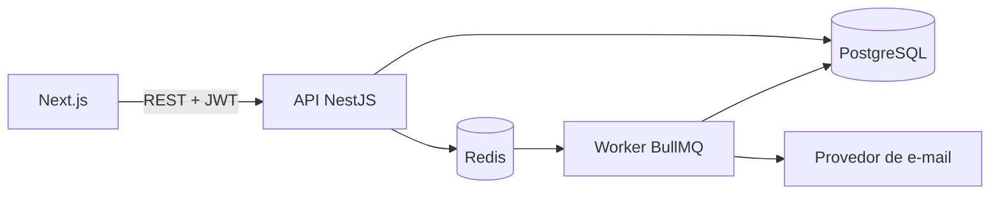
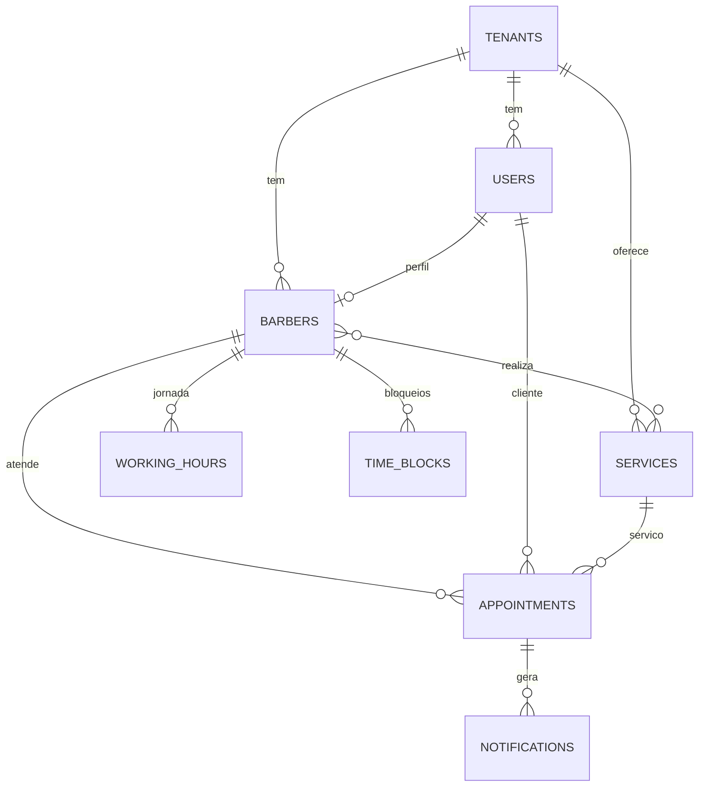

# BarberFlow

Plataforma SaaS multi-tenant de agendamento para barbearias. Cada barbearia gerencia
barbeiros, serviços e horários; os clientes agendam online, sem ligar nem mandar mensagem.

> Status: em desenvolvimento (fase 1: MVP)

## Problema

Barbearias pequenas controlam a agenda por WhatsApp e caderno: horários duplicados,
faltas sem aviso, nenhum controle de faturamento. O BarberFlow centraliza isso em uma
agenda online com lembretes automáticos e painel de métricas.

## Escopo

### MVP (fase 1)
- Cadastro de barbearia (tenant), barbeiros, serviços e jornadas
- Autenticação com papéis: dono, barbeiro, recepção, cliente
- Consulta de horários disponíveis por serviço e barbeiro
- Agendar, cancelar e remarcar
- Lembretes por e-mail (fila assíncrona)
- Painel: atendimentos, faturamento e faltas

### Fase 2
- Pagamento online (sinal ou pré-pagamento)
- Planos de assinatura (clube)
- WhatsApp
- Avaliações e fidelidade

## Stack

| Camada | Tecnologia |
|---|---|
| API | Node.js + TypeScript + NestJS |
| Banco | PostgreSQL 15+ |
| Cache / filas | Redis + BullMQ |
| Front-end | Next.js (React) |
| Testes | Jest + Testcontainers; k6 para carga |
| Infra | Docker Compose, GitHub Actions |
| Docs da API | OpenAPI / Swagger |

## Arquitetura

Monólito modular: um único deploy, com módulos de fronteiras claras.

Módulos: `auth`, `tenants`, `users`, `barbers`, `services`, `availability`,
`appointments`, `notifications`, `reports`.

## Decisões de engenharia

| Tema | Decisão | Motivo |
|---|---|---|
| Multi-tenancy | Banco único com `tenant_id` em todas as tabelas | Simples de operar e barato; isolamento reforçado na aplicação (e, na fase 2, com Row Level Security) |
| Conflito de horário | `EXCLUDE USING gist` sobre `tstzrange` | O banco garante que dois agendamentos ativos do mesmo barbeiro não se sobrepõem, mesmo com requisições simultâneas |
| Datas | Tudo em UTC (`timestamptz`); fuso de exibição por tenant | Evita bugs de horário de verão e de fuso |
| Preço | `price_cents` copiado para o agendamento | Mudar o preço do serviço não altera o histórico |
| Notificações | Tabela + fila (BullMQ) com tentativas | Falha de e-mail não derruba o agendamento |
| Arquitetura | Monólito modular, sem microsserviços | Menor complexidade; módulos podem ser extraídos depois |

## Modelo de dados

O schema completo está em [`db/001_init.sql`](db/001_init.sql).

## Cálculo de disponibilidade (resumo)

Para um barbeiro, serviço e dia:

1. Converter a jornada (`working_hours`) do dia para UTC usando o fuso do tenant
2. Subtrair `time_blocks` e agendamentos com status `scheduled`
3. Gerar slots com a duração do serviço (passo configurável, ex.: 15 min)
4. Descartar slots no passado

A reserva final sempre passa pela exclusion constraint; a consulta de disponibilidade
é apenas uma sugestão, e o banco é a fonte da verdade.

## Roadmap

- [ ] Setup do repositório, Docker Compose e CI
- [ ] Migrations e módulo de autenticação (JWT + papéis)
- [ ] Multi-tenancy (resolução do tenant e filtros)
- [ ] Barbeiros, serviços e jornadas
- [ ] Disponibilidade com testes
- [ ] Agendamento com tratamento de concorrência
- [ ] Notificações assíncronas
- [ ] Painel e relatórios
- [ ] Front-end
- [ ] Deploy e teste de carga

## Como rodar

_Será preenchido conforme o projeto evolui._
