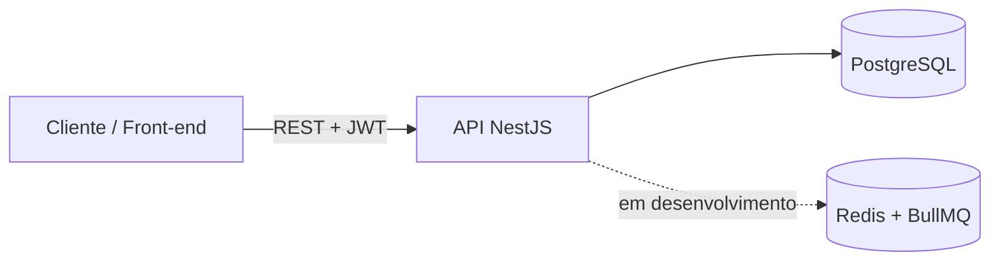
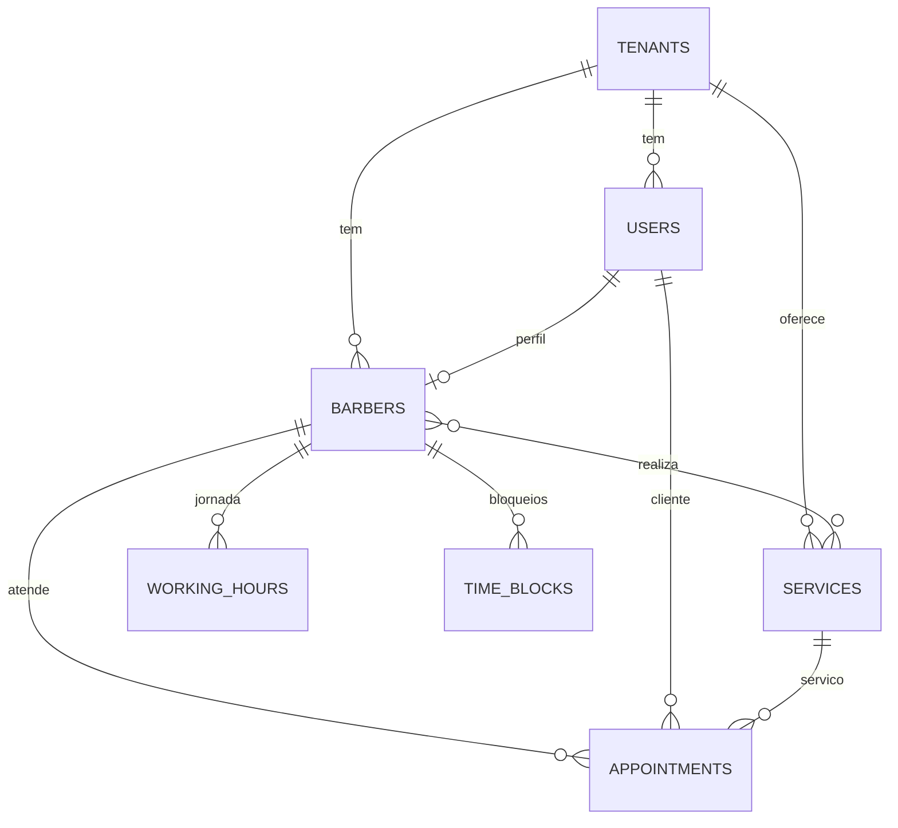

# BarberFlow

[](https://github.com/JoaozDev/barberflow/actions/workflows/ci.yml)

API de agendamento **multi-tenant** para barbearias. Cada barbearia gerencia seus
barbeiros, serviços e horários; os clientes consultam horários livres e agendam online,
sem ligar nem mandar mensagem.

> Status: back-end do núcleo de agendamento concluído e testado. Notificações,
> front-end e deploy estão no [roadmap](#roadmap).

## O que o sistema faz

- Cadastro de barbearia (tenant) e de clientes, com login e JWT
- Cadastro de serviços (duração e preço) e de barbeiros, vinculados aos serviços que realizam
- Jornada semanal por barbeiro, com pausas (vários intervalos no mesmo dia)
- Bloqueios de agenda (folga, atestado)
- Consulta de **horários disponíveis** por barbeiro, serviço e data
- Agendamento, listagem e cancelamento, com controle de acesso por papel

## Destaques de engenharia

**Concorrência resolvida no banco, e provada por teste.** Dois clientes tentando o mesmo
horário ao mesmo tempo é o caso que quebra a maioria dos sistemas de agendamento.
Aqui, a garantia vem de uma *exclusion constraint* do PostgreSQL sobre `tstzrange`: o banco
impede, por si só, dois agendamentos ativos sobrepostos para o mesmo barbeiro. A API faz uma
pré-validação amigável, mas quem decide é o banco. Um teste e2e dispara 10 reservas
simultâneas do mesmo horário e verifica que exatamente uma passa; outro teste insere
direto no banco, sem passar pela API, para isolar a constraint.

**Isolamento entre barbearias.** O `tenantId` vem sempre do token, nunca do corpo da
requisição, e toda consulta filtra por ele. Tentar acessar dado de outra barbearia
devolve 404, sem revelar que o dado existe.

**Fuso horário tratado de ponta a ponta.** O banco guarda tudo em UTC (`timestamptz`). A
jornada é cadastrada em hora local da barbearia, e o cálculo de disponibilidade converte
corretamente entre os dois. Esse cálculo é uma **função pura** com testes unitários que
cobrem pausa de almoço, bloqueios, serviços que ultrapassariam o fim da jornada e
horários que cruzam a meia-noite em UTC.

**Segurança básica.** Senhas com bcrypt, JWT com expiração, controle de acesso por papel
(RBAC), validação de entrada com lista de campos permitidos, SQL sempre parametrizado e
segredos fora do repositório.

## Stack

| Camada | Tecnologia |
|---|---|
| API | Node.js 24, TypeScript, NestJS |
| Banco | PostgreSQL 16 |
| Datas e fusos | luxon |
| Autenticação | JWT, bcryptjs |
| Documentação | OpenAPI / Swagger UI |
| Testes | Jest (unitários e e2e), supertest |
| Infra | Docker Compose, GitHub Actions |

## Arquitetura

Monólito modular: um único deploy, com módulos de fronteiras claras.



Módulos: `auth`, `services`, `barbers`, `working-hours`, `time-blocks`, `availability`,
`appointments`, `database` e `health`.

## Modelo de dados



O schema completo está em [`db/001_init.sql`](db/001_init.sql).

## API

A documentação interativa (Swagger UI) fica em `http://localhost:3000/docs` e a
especificação OpenAPI em `http://localhost:3000/docs-json`.

| Método | Rota | Quem pode |
|---|---|---|
| POST | `/auth/register-tenant` | Público |
| POST | `/auth/register-customer` | Público |
| POST | `/auth/login` | Público |
| GET | `/auth/me` | Autenticado |
| GET | `/health` | Público |
| GET | `/services` | Autenticado (cliente vê só os ativos) |
| POST | `/services` | Dono |
| PATCH | `/services/:id` | Dono |
| GET | `/barbers` | Autenticado |
| POST | `/barbers` | Dono |
| GET | `/barbers/:id/working-hours` | Autenticado |
| PUT | `/barbers/:id/working-hours` | Dono |
| GET | `/barbers/:id/time-blocks` | Autenticado |
| POST | `/barbers/:id/time-blocks` | Dono |
| DELETE | `/barbers/:id/time-blocks/:blockId` | Dono |
| GET | `/availability` | Autenticado |
| POST | `/appointments` | Cliente, dono ou recepção |
| GET | `/appointments` | Autenticado (cada papel vê o que lhe cabe) |
| PATCH | `/appointments/:id/cancel` | Cliente (os próprios), dono ou recepção |

## Regras de negócio

- **Disponibilidade:** os horários são gerados a cada 30 minutos dentro de cada janela da
  jornada, e o serviço precisa terminar dentro da janela. Somem os horários que
  se sobrepõem a bloqueios ou agendamentos ativos, ou que já passaram.
- **Agendamento:** o cliente agenda para si; dono e recepção agendam informando o cliente.
  O preço do serviço é copiado para o agendamento, então mudar o preço depois não altera o histórico.
- **Bloqueios:** não é possível bloquear um período que já tem cliente agendado (409).
- **Cancelamento:** só agendamentos futuros e ativos; ao cancelar, o horário volta a ficar livre.

## Como rodar

Pré-requisitos: **Node.js 24 (LTS)** e **Docker**.

```bash
git clone https://github.com/SEU_USUARIO/barberflow.git
cd barberflow

# 1. Banco e Redis (o schema é criado automaticamente na primeira subida)
cp .env.example .env
docker compose up -d

# 2. API
cd api
cp .env.example .env
npm install
```

Gere um segredo para o JWT e coloque-o em `api/.env` na variável `JWT_SECRET`:

```bash
node -e "console.log(require('crypto').randomBytes(32).toString('hex'))"
```

Suba a API:

```bash
npm run start:dev
```

A API responde em `http://localhost:3000` e a documentação em `http://localhost:3000/docs`.

> No Windows (PowerShell), use `copy .env.example .env` no lugar de `cp`.

## Testes

Com o Docker rodando (o banco precisa estar de pé para os testes e2e), dentro da pasta `api`:

```bash
# Unitários
npm test

# E2E: inclui o teste de concorrência com 10 reservas simultâneas
npx jest --config jest.e2e.config.ts
```

O teste e2e cria uma barbearia com slug único e apaga seus próprios dados ao final.

## Integração contínua

A cada push e pull request, o GitHub Actions sobe um PostgreSQL em container, aplica o
schema, compila o projeto e roda os testes unitários e e2e. O workflow está em
[`.github/workflows/ci.yml`](.github/workflows/ci.yml).

## Decisões e trade-offs

| Tema | Decisão | Motivo |
|---|---|---|
| Multi-tenancy | Banco único com `tenant_id` em todas as tabelas | Simples de operar e barato; o isolamento é aplicado em toda consulta. Row Level Security fica como evolução |
| Conflito de horário | `EXCLUDE USING gist` sobre `tstzrange` | O banco garante a regra, mesmo sob concorrência |
| Acesso a dados | Driver `pg` com SQL escrito à mão | O núcleo do projeto depende de recursos de SQL (intervalos, constraint de exclusão) que um ORM esconderia |
| Datas | UTC no banco, fuso por barbearia | Evita bugs de fuso e de horário de verão |
| Arquitetura | Monólito modular, sem microsserviços | Menor complexidade; os módulos podem ser extraídos depois |
| Testes e2e | Banco real, sem mocks | O comportamento mais importante (concorrência) só aparece no banco de verdade |

## Roadmap

- [x] Autenticação com JWT e papéis (dono, barbeiro, recepção, cliente)
- [x] Serviços, barbeiros, jornada e bloqueios de agenda
- [x] Cálculo de horários disponíveis (com testes unitários)
- [x] Agendamento, listagem e cancelamento
- [x] Teste e2e de concorrência
- [x] Documentação OpenAPI e CI
- [ ] Notificações assíncronas (confirmação e lembrete) com Redis e BullMQ
- [ ] Front-end do fluxo do cliente
- [ ] Deploy com link público
- [ ] Row Level Security no PostgreSQL
- [ ] Reagendamento e lista de espera
